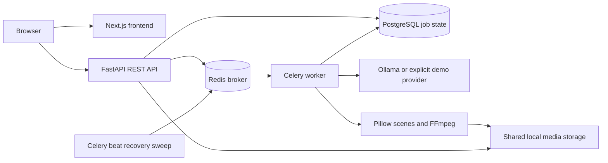

# Architecture

A modular monolith keeps request handling separate from long-running generation. FastAPI accepts bounded uploads, normalizes the image, inserts a PostgreSQL job, and publishes only its UUID to Celery. The worker persists each meaningful stage, invokes the configured provider, renders media, and marks completion only after validation. Next.js polls the job and restores it from its URL after refresh.

The frontend receives configuration from a typed backend format registry. P0 exposes only Instagram Reel at 1080 × 1920. There are no unsupported controls presented as working features.

## State and recovery

Jobs move from queued through validating, analyzing, writing_copy, rendering, finalizing, and completed; safe failures are persisted. AI network/server errors receive at most two task retries; invalid structured output has one repair attempt. Validation errors are not retried automatically. Queue publication failure becomes an explicit failed job.

An atomic claim and per-attempt UUID guard prevent duplicate task deliveries or old workers from overwriting a newer attempt. Attempt-specific artifacts avoid write collisions. `updated_at` is refreshed at each stage. Abandoned queued/processing jobs expire after the configured timeout, through both a beat task and status retrieval, and can be retried manually. Expiry is a failure/retry strategy, not automatic resumption. PostgreSQL remains authoritative; no Celery result backend is needed.

The database insert and broker publish are separate operations. Safe failure handling and stale expiry cover normal loss cases; a transactional outbox is the next reliability improvement for stronger delivery guarantees.

## Media and AI boundary

Ollama analyzes images and writes structured copy/storyboards. It does not generate finished visual media. Pillow makes scenes using the uploaded image; FFmpeg adds subtle motion/fades and encodes silent H.264/yuv420p video. Validation checks dimensions, duration, codec/container, then decodes all frames. Output is published atomically after validation.

Demo mode skips inference explicitly and supplies generic copy without product benefits/specifications. Media rendering remains real. Prompts prohibit unsupported factual claims; users must still review model output before publishing.

## Storage and deployment

The API and worker share one local filesystem. Database rows contain paths and JSON metadata, not media bytes. This suits a single-host assessment deployment; multi-host production needs object storage and signed downloads. Application containers are supplied, but their builds are not verified in the current Docker-less environment.

For an offline local demo only, SQLite and Celery's filesystem transport replace PostgreSQL/Redis. The same API, separate worker, renderer, and state contracts are exercised. This is a documented development trade-off, not a production scaling option.
