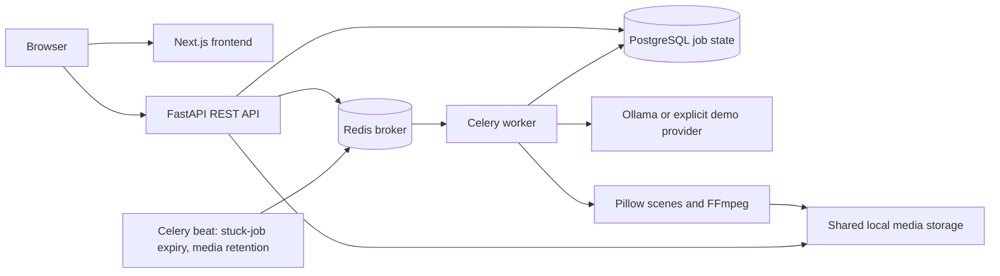

# Architecture

A modular monolith keeps request handling separate from long-running generation. FastAPI accepts bounded uploads (normalizing images, probing videos and extracting a keyframe) or a pre-validated product URL, inserts a PostgreSQL job, and publishes only its UUID to Celery. The worker persists each meaningful stage, invokes the configured provider, renders media, and marks completion only after validation. Next.js polls the job and restores it from its URL after refresh.

The frontend receives configuration from a typed backend format registry (`app/core/platforms.py`): seven formats across Instagram, TikTok, and YouTube, each declaring output kind (video/image), exact dimensions, caption length, and hashtag limits. The renderer, validator, copy prompt, post-text composer, and UI all read from it, so adding a format is a data change plus a test.

## Inputs

| Input | API step | Worker step |
| --- | --- | --- |
| Image | MIME/extension/content/pixel validation, metadata-stripped JPEG | analyze → copy → render |
| Video | Streamed to disk under a byte cap; ffprobe checks container, codec, dimensions, duration; keyframe extracted for templates; four frames sampled into a 2×2 storyboard | analyze storyboard (multi-frame) → copy → reframe source video (or poster from keyframe for image formats) |
| URL | Scheme/port/credential checks and DNS → public-IP check for fast feedback | `fetching` stage: SSRF-safe fetch, Product JSON-LD and Open Graph extraction, up to three image candidates downloaded and normalized, then the image path |

URL fetching runs in the worker, not the request: it is slow, untrusted network I/O, and it gets a visible stage, safe error codes (`URL_BLOCKED`, `URL_NO_IMAGE`, `URL_TIMEOUT`, …), and transient retries. A retry after a successful fetch reuses the stored image.

## State and recovery

Jobs move from queued through validating, fetching (URL inputs), analyzing, writing_copy, rendering, finalizing, and completed; safe failures are persisted. AI network/server errors receive at most two task retries; invalid structured output has one repair attempt. Validation errors are not retried automatically. Queue publication failure becomes an explicit failed job.

An atomic claim and per-attempt UUID guard prevent duplicate task deliveries or old workers from overwriting a newer attempt. Attempt-specific artifacts avoid write collisions. `updated_at` is refreshed at each stage. Abandoned queued/processing jobs expire after the configured timeout, through both a beat task and status retrieval, and can be retried manually. Expiry is a failure/retry strategy, not automatic resumption. PostgreSQL remains authoritative; no Celery result backend is needed.

The database insert and broker publish are separate operations. Safe failure handling and stale expiry cover normal loss cases; a transactional outbox is the next reliability improvement for stronger delivery guarantees.

## Media and AI boundary

Ollama analyzes images and writes structured copy/storyboards, guided by the selected format's platform tone and limits. It does not generate finished visual media. Rendering is real and has three paths:

- **Image formats:** Pillow composes a poster (brand, product card, hook, CTA pill) with layouts for portrait, square, and landscape canvases; the JPEG is reopened and its exact dimensions verified.
- **Video from a still (promo, `promo.py`):** the backdrop is the product photo itself, blurred and tinted in its own colour; the product sits in a shadowed card at its own aspect ratio (no mat). A shot plan runs whole product → close-up detail shots (push-in, pan, pull-back) → whole product on an end card with a CTA button. Captions slide in under a growing accent bar, scenes cross-fade, and the backdrop drifts. Frames are composed in Pillow with sub-pixel sampling (FFmpeg's zoompan jitters on slow moves) and streamed to FFmpeg as raw video; silent H.264/yuv420p. Posters for image formats use the same design. Optional user music is normalized, faded, and fitted to the video's length; for video input it is mixed under the source audio.
- **Video from a video:** the source is scaled to fit inside the target over a blurred, darkened cover-scaled copy of itself (no distortion, no cropping of the product), trimmed to the format limit, with time-windowed hook/CTA overlays and a brand badge; source audio is re-encoded to AAC.

Video validation checks dimensions, duration, codec/container, then decodes all frames. Output is published atomically after validation.

Demo mode skips inference explicitly and supplies generic copy without product benefits/specifications. Media rendering remains real. Prompts prohibit unsupported factual claims; users must still review model output before publishing.

## Storage and deployment

The API and worker share one local filesystem. Database rows contain paths and JSON metadata, not media bytes. This suits a single-host assessment deployment; multi-host production needs object storage and signed downloads. Application containers are supplied, but their builds are not verified in the current Docker-less environment.

For an offline local demo only, SQLite and Celery's filesystem transport replace PostgreSQL/Redis. The same API, separate worker, renderer, and state contracts are exercised. This is a documented development trade-off, not a production scaling option.
